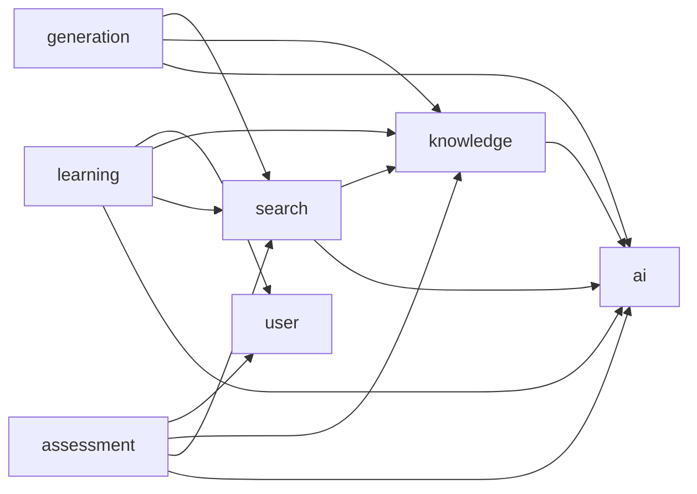
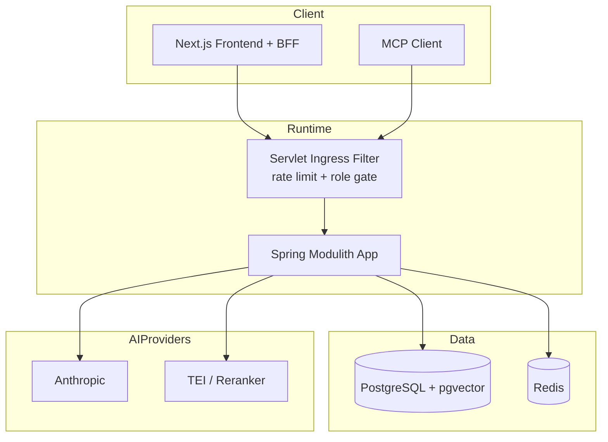
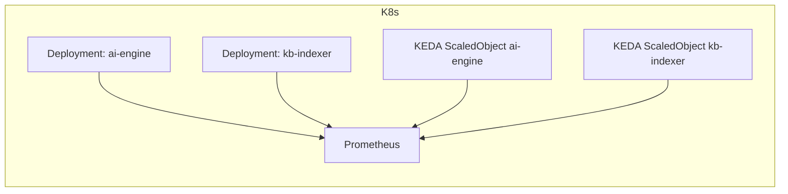

# Architecture Spine — spring-tech-kb-service

## Design Paradigm

采用**模块化单体（Modulith）**作为主范式：`ai / knowledge / search / learning / assessment / generation / user` 七个业务模块在同一进程内运行，通过公开 API、DTO 与事件协作，`internal` 包仅模块内可见；运行态通过 `all / ai-engine / kb-indexer` 角色切分实现“逻辑拆服务、物理同仓同镜像”。

## Invariants & Rules

### AD-1 — 模块边界以 `package-info + ModularityTests` 为唯一约束源 [ADOPTED]

- **Binds:** all
- **Prevents:** 业务模块之间随意跨包调用、直接依赖他模块 `internal` 实现
- **Rule:** 新增或修改模块边界时，必须同步更新 `package-info.java` 的 `@ApplicationModule(allowedDependencies=...)`；跨模块协作仅允许经公开类型（根包接口/DTO/事件）；`ModularityTests` 必须持续通过。

### AD-2 — 依赖方向固定为“能力上行，基础下沉” [ADOPTED]

- **Binds:** ai, knowledge, search, learning, assessment, generation, user
- **Prevents:** 循环依赖与“检索/学习/评估反向侵入 AI 或用户模块”的漂移
- **Rule:** `ai` 与 `user` 为底层能力；`knowledge/search/generation` 与 `learning/assessment` 只能依赖声明允许的下游模块，不得引入隐式共享实现包。



### AD-3 — 状态变更按“模块内所有权”执行

- **Binds:** all
- **Prevents:** 多模块直接写同一业务状态导致并发覆盖、语义冲突和审计失真
- **Rule:** 每类业务状态仅由其所有者模块服务写入：认证/用户态归 `user`，知识内容与入库归 `knowledge`，RAG 流编排归 `search`，模型调用与配额归 `ai`，学习计划与进度归 `learning`，评测/判题/能力追踪归 `assessment`，生成资产归 `generation`；其他模块只能调用公开接口，不直接跨模块写库。

### AD-4 — 知识入库必须“同事务双写 + outbox 完成确认” [ADOPTED]

- **Binds:** knowledge, search
- **Prevents:** 向量索引、词法索引与来源审核状态不一致导致检索混杂
- **Rule:** 文档入库时，来源、chunk、审计记录、向量与 `knowledge_index_outbox` 必须按既定流程写入；提交后由投递器完成向量投影核验、失败退避重试与死信；任何绕过 outbox 的索引更新实现均不允许。

### AD-5 — RAG 路径固定为“检索优先 + 不可信上下文 + 无工具执行” [ADOPTED]

- **Binds:** search, ai
- **Prevents:** 间接 Prompt 注入、路径分叉引起的不可复现实验结果、引用缺失
- **Rule:** 在线问答统一经过意图分类→检索（FAST/AGENTIC/CAG）→Rerank→稳定前缀 Prompt→SSE 输出；检索文本视为不可信上下文；RAG Chat 路径不注册工具调用；事件输出必须包含 `token/citation/done/error` 语义。

### AD-6 — Prompt 与缓存命名空间按版本隔离，计量三列强制落地 [ADOPTED]

- **Binds:** ai, search
- **Prevents:** Prompt 灰度与缓存相互污染、成本不可核算、跨版本答案串用
- **Rule:** `PromptRegistry` 提供版本化与稳定分桶 canary；缓存命名空间必须包含 Prompt 版本；LLM 计量必须区分 `input/output/cache_read` 并记录 TTFT 与总时延；配额失败默认降级到 LITE 档。

### AD-7 — 运行角色分裂优先于代码分仓 [ADOPTED]

- **Binds:** deployment, api ingress, operations
- **Prevents:** 过早物理拆分带来的协作复杂度与一致性破坏
- **Rule:** 统一镜像以 `SPRINGTECHKB_RUNTIME_ROLE` 控制行为：`all` 兼容单体、`ai-engine` 提供在线 API、`kb-indexer` 禁止对外业务入口并专注离线索引；网关过滤器必须在入口层执行角色隔离与限流。

### AD-8 — 认证边界为“后端 JWT 权威 + 前端 HttpOnly 承载” [ADOPTED]

- **Binds:** user, security, frontend bff
- **Prevents:** token 泄露、越权访问、前端伪造身份
- **Rule:** 后端为 OAuth2 Resource Server + JWT 验签权威；除明确白名单外 `/api/**` 与 `/mcp/**` 需认证；前端仅通过 HttpOnly Cookie 维持会话，不在浏览器暴露 token；管理员能力由后端角色校验，不以前端展示态作为安全边界。

## Consistency Conventions

| Concern | Convention |
| --- | --- |
| Naming (entities, files, interfaces, events) | 模块公开类型放根包，非公开实现放 `internal`；跨模块契约优先接口（如 `KnowledgeGraph`、`KnowledgeQueries`、`RagChatGateway`）。 |
| Data & formats (ids, dates, error shapes, envelopes) | 主键统一 UUID；流式问答统一 SSE 事件名；时间与配额按 UTC 日切；配置由 `application.yml` + 环境变量注入。 |
| State & cross-cutting (mutation, errors, logging, config, auth) | 变更优先事务边界内完成；失败显式返回（4xx/5xx 或 SSE `error`）；指标/追踪默认开启但敏感内容默认不出 trace；认证与授权由 Spring Security/Method Security 统一收口。 |

## Stack

| Name | Version |
| --- | --- |
| Java | 21 |
| Spring Boot | 4.1.2 |
| Spring AI | 2.0.2 |
| Spring Modulith | 2.1.2 |
| Spring Security (OAuth2 Resource Server) | 7.x (via Boot 4.1.2) |
| PostgreSQL + pgvector | PostgreSQL 17 (local image `pgvector/pgvector:pg17`) |
| Redis | 7.x |
| Flyway | 11.x line (via `spring-boot-starter-flyway`) |
| Resilience4j | 2.3.0 |
| JGit | 7.3.0 |
| JavaParser | 3.27.0 |
| Next.js | 15.5.28 |
| React | 19.1.2 |
| TypeScript | 5.x |
| KEDA | 2.x |

## Structural Seed





```text
spring-tech-kb-service/
  src/main/java/com/springtechkb/
    ai/            # 三档模型路由、熔断、计量、结构化生成
    knowledge/     # 采集、准入、分块、入库、outbox
    search/        # 混合检索、RAG、MCP工具、Prompt使用方
    learning/      # 学习计划与任务进度
    assessment/    # 评测、判题、BKT/IRT、能力报告
    generation/    # 示例/对比/项目骨架生成
    user/          # 认证、用户档案、技能状态
  src/main/resources/db/migration/  # V1..V17 演进迁移
  frontend/        # Next.js 应用与同源 BFF
  infra/k8s/       # ai-engine / kb-indexer / KEDA / scrape RBAC
```

## Capability → Architecture Map

| Capability / Area | Lives in | Governed by |
| --- | --- | --- |
| 知识采集与准入 | `knowledge` | AD-3, AD-4 |
| 混合检索与 RAG SSE | `search` + `ai` | AD-2, AD-5, AD-6 |
| Prompt 灰度与配额治理 | `ai` + `search` | AD-6 |
| 学习规划与任务追踪 | `learning` + `knowledge` + `user` | AD-2, AD-3 |
| 评测、判题与能力模型 | `assessment` + `ai` + `user` | AD-2, AD-3 |
| 示例与项目骨架生成 | `generation` + `search` + `ai` | AD-2, AD-3 |
| MCP 对外只读知识工具 | `search` | AD-5, AD-8 |
| 角色化部署与伸缩 | `infra/k8s` + root gateway filter | AD-7 |

## Deferred

- 物理微服务拆分（独立仓库/独立数据库）延后：当前运行角色分裂已满足阶段目标，待跨团队并行与容量证据出现后再推进。
- Kafka 引入延后：现阶段 outbox + dispatcher 可满足一致性与吞吐需求，按既有 DEC-04 门槛复评。
- Elasticsearch 引入延后：保留 PostgreSQL FTS + pgvector，按 DEC-05 的负载与质量门槛复评。
- 内核级沙箱（gVisor/Kata）生产化细节延后：当前代码沙箱已具备基线能力，需在目标集群完成隔离与运维闭环后升级为强隔离方案。
